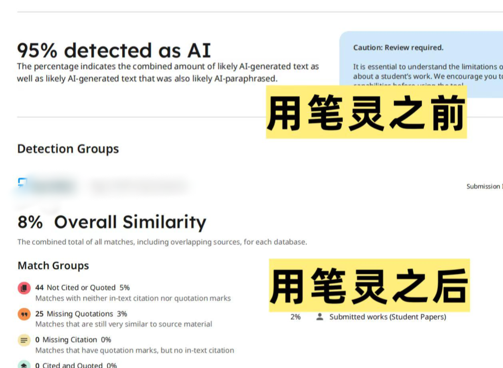
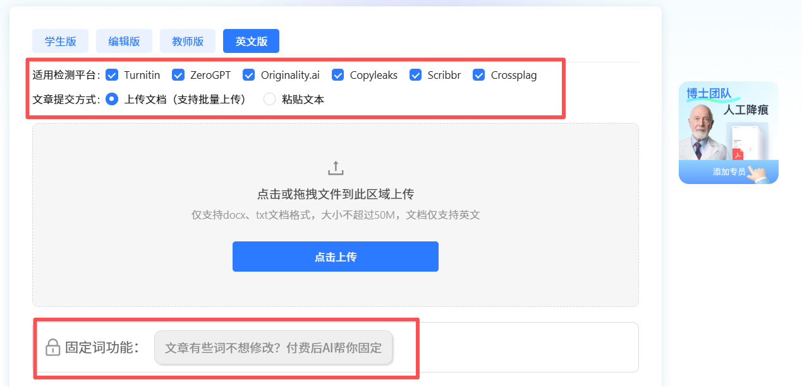
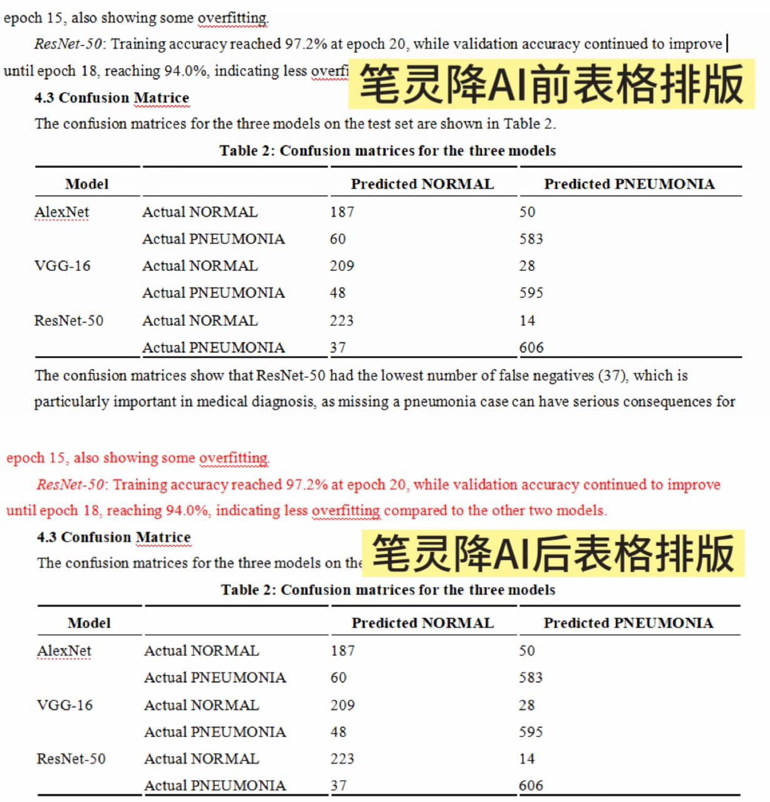
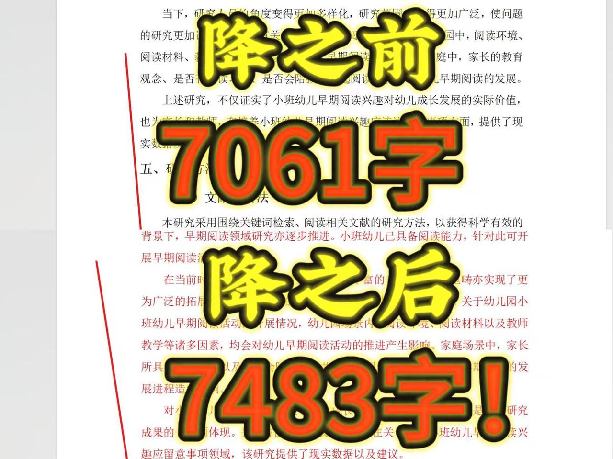

# 英文论文被误判AI？亲测靠谱英文降AI，轻松通过AIGC检测

## 一、真的巨冤！手写英文论文全被标AI

不知道有没有同款小伙伴，整篇Essay、Report都是自己一点点查文献、手写打磨的，结果交之前自测，**英文ai率检测**飙高！

**AIGC检测**数值居高不下，不管是**ZeroGPT、Copyleaks、Originality**哪个平台测，都是大片飘蓝。明明是自己熬夜写的原创，却被判定成机器生成。

为了**降低英文的aigc率**，我之前试了一堆**英文aigc免费降重网站**，手动换词、改语序、拆句子，折腾大半天完全没用，根本没办法**Humanize AI**。

踩了无数坑之后，总算找到一个适配新版算法的办法，纯个人自用测评，分享给大家！

## 二、为啥纯手写也会被误判？终于搞懂了

之前一直百思不得其解，自己纯手写的内容，凭啥疯狂判AI？

后来慢慢摸清规律了，2026年**Turnitin**算法悄悄升级之后，检测逻辑变严超多。

它现在不只是查重复率，更看重整篇文章的句式节奏、行文逻辑。

我们平时写的学术英文都比较规整，刚好贴合AI写作的特征，所以特别容易被系统误伤误判。

现在网上那些老的改稿方法基本都失效了，瞎改只会越改机器感越重，大家也别慌，这种**AI误判**真的超级普遍，做**英文降AI**只是规避系统bug，就是单纯保护自己的作业成果！

## 三、自用实测｜笔灵英文降AI适配新算法

对比了好多工具，淘汰了一堆没用的，现在我定稿一直用的就是**笔灵AI**，完全是学生党刚需神器！

工具入口：[笔灵英文降AIhttps://u\.ibiling\.cn](https://ibiling.cn/paper-pass/english?from=githubywjiangai1009jw)

我之前有篇文章，AI检测九十多，满屏标蓝，基本属于高危状态。抱着试一试的心态用它处理，改完之后复测直接降到安全个位数，全平台过检，真的很惊喜。

我用过几次后，感受得出来它是根据整体调整句式节奏，打乱机器死板的行文逻辑，这样就能从根源**降低英文的aigc率**，稳稳实现**Humanize AI**。

而且它有固定词功能，这样专业内容不乱动，像专业术语、实验数据、核心论点这些关键内容，它都会锁定保护，只优化生硬、模板化的语句，不会改偏观点、改错数据，完全不影响论文专业性。

我写论文最烦的就是改完还要重新排版！这个工具可以直接整篇文档上传，表格、段落、原有格式全部保留，改完下载就能用，赶DDL真的省超多时间\~反正我是心动了hh。

我还踩过很多坑，有的工具改完字数忽多忽少，还要自己手动删减增补，笔灵改写前后字数几乎没变化，完全贴合学校的字数要求，不用额外折腾啦！

## 四、个人小建议｜定稿稳稳不翻车

最后分享两个我一直坚持的小习惯，能最大程度避免交稿踩雷：

1、改完千万别直接提交！先用工具做一次**英文ai率检测**，确认AI痕迹清零、数值达标再定稿，提前规避风险。

2、简单通读一遍全文，微调一下语句衔接，贴合自己的写作风格，彻底去掉残留的机器感。

还是那句话，工具只是辅助！论文核心逻辑和内容，一定要自己把控，遵守学术规范就完全没问题～

